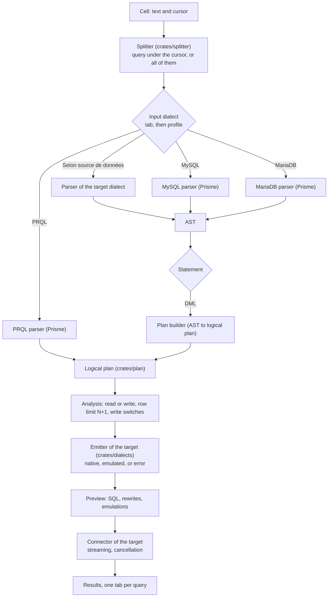

# Prisme v1: multi-database client as a notebook

This document sets the scope of the v1, the decisions taken and the known risks. The **[to confirm]** marks flag a proposal not explicitly approved yet.

## 1. Scope

The v1 is a web database client, shaped like a notebook:

1. Save connections to various databases.
2. Record metrics on the database, the tables, the rows and the columns.
3. A simple object explorer.
4. SQL input in various versioned dialects, to choose from: MySQL, MariaDB, PostgreSQL, SQLite, Tutorial D, DuckDB.
5. Support for native transactions.
6. Query various databases in their native dialect.
7. Several queries typed in a single field: Ctrl+Enter runs the one where the cursor is, Ctrl+Shift+Enter runs them all, one after another or in parallel.
8. If several queries are run, one result tab per query.
9. All of it as a notebook.
10. Being able to enable or disable UPDATE, DELETE, CREATE, DROP, ALTER.
11. Limit the number of rows returned ("hard" limit).

The input dialect can differ from the dialect of the target database. **Queries must therefore be rewritten from one dialect to the other as early as the v1**, which brings the core of the engine (parser, logical plan, emitters per dialect) into the v1. It is the same core as the future federated engine's (see `docs/FEDERATED.md`).

## 2. Decisions

### 2.1 Translation between dialects

- **Input dialect**: the user writes each query in a dialect of their choice, among MySQL, MariaDB and PRQL. The choice is a preference of the user's profile, "Preferred dialect", whose values are:
  - "Selon source de données" (according to the data source): the SQL is written in the native dialect of the target, with no rewriting. It is offered for SQL only, as PRQL is always compiled to the target.
  - MySQL, MariaDB, PRQL.
  The editor tab can override the profile's value. Per-tab settings come with the notebooks, to be specified later.
- Same input and target dialect: the query also goes through the transpiler (logical plan, then emitter of the target), so that every input gives the same output and the same audit information. The emitter must then be exact for the native dialect as well, which the conformance suite checks.
- Different dialect, SQL input: parser of the input dialect, AST, plan builder (AST to logical plan), then emitter of the target. Pairs are added one at a time, with tests: MySQL and MariaDB first (very close), then PostgreSQL, SQLite, DuckDB, then the Tutorial D subset.
- **PRQL input**: a PRQL parser written by Prisme, with no external PRQL compiler, covering the whole language, from scratch. The reference is the PRQL book (https://prql-lang.org/book/). PRQL only reads: each step maps to a plan node, and the query goes to the emitter of the target dialect.
- **One pivot, the logical plan** (`crates/plan`): whatever the input dialect, the query becomes the same plan, which the emitter of the target turns into SQL. The transpilers therefore give the same SQL and the same audit information for the same query.
- **Emulations are performed locally**, by Prisme's own rewriting, not left to the target database: the federated engine (see `docs/FEDERATED.md`) will need them anyway, since a query can mix several sources.
- **Audit of the transpilation**: the user can read the transpiled query before and after running it, for validation or audit. The preview lists every rewrite (for example `VALUES ROW(...)` turned into `VALUES (...)`) and marks the emulations.
- **Non-translatable**: to be defined, with the list of cases (open point in `docs/QUESTIONS.md`). A query can be split, and its subqueries delegated to the sources, before being joined by Prisme: this depends on the execution plan, also open.
- Principle: "nothing is untranslatable". For example, `date_trunc` can be rephrased with `date_format`. The function catalog of each dialect therefore has three levels:
  1. **Native**: the function exists, it goes through as is.
  2. **Emulated**: an equivalent expression is generated. It must keep the result **type**: `DATE_FORMAT` returns a string, so it is wrapped in `CAST(... AS DATE)` or `CAST(... AS DATETIME)`. For the week: `DATE_SUB(d, INTERVAL WEEKDAY(d) DAY)`. For the month: `DATE_FORMAT(d, '%Y-%m-01')`.
  3. **Unsupported**: explicit error, only when no correct emulation exists. Expected remaining cases: old versions (MySQL 5.7 has neither CTEs nor window functions) and needs for local evaluation, impossible as long as a query targets a single database.
- An emulation can prevent the use of an index: `WHERE CAST(DATE_FORMAT(col, ...) AS DATE) = X`. When possible, rewrite as a range (`col >= start AND col < end`).
- **Preview of the translated query** available before running, with an "emulated" marker.
- **DML goes through the plan**: `SELECT`, `INSERT`, `UPDATE`, `DELETE` are plan nodes, translated by the same rules (native, emulated, or error).
- **Catalog and session statements go through the plan too** (`SHOW`, `DESCRIBE`, `EXPLAIN`, `USE`, `SET`, queries on `information_schema`, later on `sqlite_schema` or `pg_catalog`): Prisme translates them as far as needed. Listing the tables of a MySQL database with the SQLite dialect (`SELECT name FROM sqlite_schema WHERE type = 'table'`) gives a query on the catalog of MySQL. When the target gives less than the same request written in its own dialect, the report states the loss of precision.
- **DDL set aside for now**: types, auto-increment, indexes, stored programs and `DELIMITER` blocks are not covered by the plan in the v1 (open point, `docs/QUESTIONS.md`).
- The emitters, the plan builders and the parsers (SQL and PRQL) are written by Prisme, one parser per dialect, without external dependency (decided). `sqlparser-rs` is a dev-dependency, as an oracle in the tests (`docs/QUESTIONS.md`, point 38).
- The AST of Prisme's parsers and its walk serve to read the SQL input (classification, aliases, functions, identifier quotes). The translation itself goes through Prisme's logical plan, which is therefore needed from the v1, not only for Tutorial D and the federated engine.
- The same query must give the same result on each database: the NULL rules of `docs/FEDERATED.md` (section 7, points 1 to 6) are therefore needed from the v1.

### 2.2 MySQL and MariaDB

They are told apart: close but not identical syntaxes. Each has its catalog and its versions, with a common base. Differences to handle, to check version by version:

- `RETURNING` on `INSERT` and `DELETE` (MariaDB only), and sequences.
- `JSON`: an alias for text in MariaDB, a native type in MySQL, different functions.
- `sqlparser-rs` 0.63 has no MariaDB dialect. Checked on the crate's source and by a probe: its MySQL dialect parses `VALUES ROW(...)` and keeps the flag in the AST (`Values::explicit_row`, so the MariaDB rewrite of the example is a flag set to `false`), but refuses `JSON_TABLE` with `COLUMNS` (present in MySQL 8.0 and MariaDB 10.6) and the `AS OF` of system versioning (MariaDB only). Among its dialects, only the MySQL one accepts `PARTITION (p)` and `STRAIGHT_JOIN`, which MariaDB has too. The MySQL and MariaDB parsers of Prisme (in `crates/dialects`) share a common grammar, `JSON_TABLE` included; the MariaDB parser adds what only MariaDB has (`AS OF` among others), in the v1, right away.
- `EXCEPT ALL` and `INTERSECT ALL`: different minimum versions (MySQL 8.0.31 or later for MySQL).
- Default collations, authentication plugins, `information_schema` tables and `EXPLAIN` output (explorer and metrics).
- `mysql_async` serves both, but the conformance tests run on both separately.

### 2.3 Row limit ("hard")

Final rule: the application adds a `LIMIT` if the user did not specify one. Otherwise, the user's limit applies, whatever it is, without a ceiling.

- No limit written: add `LIMIT N + 1`, show N rows, report "truncated result" if the extra row arrives.
- **Value of N**: 1,000 by default, to choose among 1,000, 2,000, 5,000, 10,000 and 50,000. It is a user setting, which a query can also specify for itself only. The list of choices is a single constant of the code, easy to change.
- Limit written: it goes through as is, without a truncation message. The following count as limits: `LIMIT n`, `LIMIT a, b`, `FETCH FIRST`, `LIMIT ALL` (PostgreSQL), `LIMIT -1` (SQLite, meaning no limit).
- Only for queries that return rows (`SELECT`, `WITH ... SELECT`, `VALUES`, `TABLE`). Never on `SHOW`, `EXPLAIN`, `PRAGMA`, `CALL`, nor on writes.
- Inserted at the AST or token level, without concatenating text. In MySQL, `LIMIT` comes before `FOR UPDATE` and `INTO OUTFILE`. On a `UNION`, it applies to the whole.
- Query that cannot be analysed: do not rewrite it, read in streaming, stop at N rows and cancel on the server side.
- Tutorial D has no `LIMIT`: the `Limit` node of the plan handles it.
- This limit is a **default**, not a protection. A `LIMIT 50000000` typed by the user must stay bearable: streaming reads (never a full array in memory), paginated or virtualised display on the Vue side, cancellation possible at any time.
- Future option: an absolute ceiling configurable per role, disabled by default.

### 2.4 Write switches

- Classification by the **AST**, not by the text: the analyser knows whether a query is a read, a write or DDL, and blocks it before running.
- Text alone can be bypassed: `WITH ... DELETE` in PostgreSQL, stored procedures, `SELECT ... INTO OUTFILE`, `COPY`, `PRAGMA` in SQLite, `ATTACH` in DuckDB.
- Hence **double protection**: a read-only connection account on the database side, or a `READ ONLY` transaction when the engine offers it. Without it, the switch is only a convenience safeguard.
- Implemented for MySQL and MariaDB: the profile has the setting **Sessions en lecture seule**, on by default (`users.read_only_session`). When it is on, each connection of a query session runs `SET SESSION transaction_read_only = ON` as its last initialisation statement, so that the connection's own statements cannot switch it off (`crates/server/src/connections.rs`, `with_read_only`).
- Audit log of all writes.
- **Until stage 4**: query sessions refuse any write (DDL and `CALL` included), as well as queries that cannot be analysed, which Prisme cannot verify to be reads. Allowed: `SELECT` and its variants that return rows, `SHOW`, `DESCRIBE`, `EXPLAIN` (except `EXPLAIN ANALYZE` of a write) and `USE`. A stored function called in a `SELECT` can still write: only a read-only account prevents it.

### 2.5 Transactions, sessions, cancellation

- An HTTP request is stateless, whereas a transaction lives on a connection. Each notebook session therefore keeps its connections in a **long-lived task**, with an idle timeout and an automatic rollback if the user disappears.
- Implementation: an editor's session outlives its WebSocket. After a disconnection (page reloaded, browser closed), it stays open for the delay set on the connection (5 minutes by default, from 0 to 24 hours, **Session gardée** (Session kept) field), running queries included; the page that comes back reattaches to it and receives the last batch where it stands. After that delay, the queries are interrupted and the connection closed, which rolls back an open transaction on the server side. Closing the editor, editing or deleting its connection closes the session at once (`crates/server/src/sessions.rs`, `session_relay.rs`).
- A transaction cannot span queries run in parallel, which use distinct connections. The interface must say so clearly.
- Cancellation: `KILL QUERY` through a second connection in MySQL and MariaDB, `CancelToken` in PostgreSQL, interruption of the running query for SQLite and DuckDB (mechanism to check in `rusqlite` and `duckdb`).
- **Stopper (Stop) button**: it stops all the running queries and loads of the cell. In MySQL and MariaDB, each running query receives `KILL QUERY` on its connection, the reading of its rows stops, and the queries waiting for their turn (parallel execution) do not start. Each one ends with the error "query interrupted by the user".

### 2.6 Query splitter (Ctrl+Enter)

Knowing which query is under the cursor requires a splitter **per dialect**: strings, comments, MySQL's `DELIMITER`, PostgreSQL's dollar quoting. It is simpler than a full parser, but it has to be written (`splitter` crate).

Behaviour:

- **Ctrl+Enter** runs the query under the cursor. If the cursor is between two queries (after the `;` of one, before the start of the next), it is the previous one.
- **Ctrl+Shift+Enter** runs all the queries **in parallel**, and each query opens its own result tab.
- Implementation: the session splits the text on the server side (`splitter` crate, positions in UTF-16 units like the editor). In parallel, each query has its own connection, opened on the session's current database, eight at most at a time; a `USE` or a `SET` of the batch therefore touches neither the other queries nor the session. PostgreSQL's dollar quoting will come with PostgreSQL.

### 2.7 Metrics

A `COUNT(*)` over tens or hundreds of millions of rows is slow: use the estimates of `information_schema` or of the engine's catalog, with an explicit refresh. The exact list of v1 metrics is still to be set (see `docs/QUESTIONS.md`, section 5).

### 2.8 Security and users

- Two deployment modes:
  - **Workstation**: a single user, without authentication. The server only listens on `127.0.0.1`, so that no other machine of the network can reach the saved connections.
  - **Server**: several users, mandatory authentication, users' passwords hashed (`argon2`).
- **The v1 targets the workstation.** Moving to the server mode must stay easy, hence three rules from stage 1:
  1. A users table exists from the start. The first user is created on first launch, with the email address asked in the terminal (`me@local` by default, ticket #6), along with the listening port; both are saved in the internal database.
  2. Everything that belongs to a user (connections, notebooks) carries their id from the start, even with a single user.
  3. Routes always receive "the current user" from a single entry point: the `axum` extractor `CurrentUser` (`crates/server/src/auth.rs`), which plays the role of a middleware. In workstation mode, it returns the single user. In server mode, it will check the session. Switching from one mode to the other amounts to changing this extractor and adding a login screen.
- **Requests** (workstation mode): the server accepts a request only if its `Host` is a loopback name (`localhost`, `127.0.0.1`, `[::1]`) and, when the browser sends an `Origin`, that origin is the same host. This closes DNS rebinding, where a page of another site would reach the server through `127.0.0.1` (`crates/server/src/request_guard.rs`).
- **Roles** (read-only, administration with deletion and updates on the servers): after the v1. The allowed CSV folders are set per role (see `docs/FEDERATED.md`, section 8).
- **Encryption** (`aes-gcm`), in both modes: only the secrets of the connections are encrypted (password, and later TLS or SSH keys). Host, port, user and database stay in clear, so that the explorer lists the connections without decrypting anything.
- **Master key** of the encryption: 32 random bytes (AES-256), generated on first launch and stored base64-encoded in a `prisme.key` file of the data folder (`%APPDATA%\Prisme` on Windows), readable by the user's account only. Whoever copies the whole folder takes the database and the key. Losing the key requires typing the connection passwords again, without touching the rest. Another source (environment variable, system keychain) can be added for the server mode without migration, the encrypted format staying the same.

### 2.9 Beautifier (**Enjoliver**, Beautify)

Button that rewrites the editor's text as "beautiful SQL", following rules added one at a time. The output is generated from the logical plan (the pivot of the transpiler, see section 2.10): strings and identifiers between backticks are kept identical, and the comments are kept, attached to the nodes of the plan. Ctrl+Z undoes it.

**Comments**: the parsers of Prisme keep them with their spans, as `sqlparser-rs` does (`Parser::parse_sql_with_comments`, checked in a probe), and the nodes of the AST carry their span. Each comment is attached to a plan node by its position: to the node that follows it on the next lines (leading comment), or to the node that precedes it on the same line (trailing comment). A comment that no node can take goes to the enclosing node, up to the statement: no comment is lost. A line comment (`--`, `#` in PRQL) forces a line break after it in the output. Test invariant: the same comments, with the same text, come out of the beautifier as went in. The spans of each node type are checked one by one, as `Spanned` is not guaranteed for all of them.

The DML goes through the plan (section 2.1), and the rules below apply to it, with the comments attached to the nodes of the plan. DDL is set aside for now.

1. **Normalised whitespace**: "exotic" whitespace (no-break space, thin space, ideographic space...), frequent in text copied from a web page or a word processor, becomes normal spaces; Unicode line separators, line breaks; a tab, four spaces. Zero-width invisible characters (zero-width space U+200B, byte order mark U+FEFF...), which arrive the same way and make a query fail without showing anything, are removed. Strings and identifiers between backticks stay intact: a whitespace there is part of the value. Comments are normalised.

2. **`AS` before aliases**: a column or table alias written without `AS` gets it (`SELECT count(*) n FROM video v` becomes `SELECT count(*) AS n FROM video AS v`). `AS` is optional in MySQL and MariaDB: the meaning does not change. Aliases are found by the analyser (a walk of the AST), never by the text: `DAY` in `INTERVAL 1 DAY` is not an alias. After a part the analyser does not understand, analysis resumes at the point of failure: `sqlparser` skips the body of MySQL procedures, but the queries of that body (`SELECT`, `DELETE`, `IF ... END IF`...) are analysed. The same analysis serves the function name rule.

3. **Function names in capitals** (`COUNT(*)`, `CONCAT(...)`, `NOW()`), except the user's functions and procedures, written in the case of their definition: the interface sends the server the names read in the connection's catalog. The meaning does not change: in MySQL and MariaDB, a function or procedure name is case-insensitive. Calls are found by the analyser (`Function` nodes of the AST, `CALL`): in `INSERT INTO t (a)`, `t` is not a function. The few functions with their own syntax (`EXTRACT`, `SUBSTRING`, `TRIM`, `POSITION`, `FLOOR`, `CEIL`...) are recognised by their name followed by a parenthesis, except after a word that announces a table or an index (`INTO`, `TABLE`, `ON`...). Without a loaded catalog, a user function goes to capitals.

4. **Keywords in capitals, names as written in the catalog**: beautifying starts from the analysis of the query (`analysis` module of `crates/dialects`), the same understanding as the one before running, and which will serve name resolution in the federated engine.
   - A word that the query uses as a keyword goes to capitals, reserved or not: `CAST(x AS CHAR)`, `DATE '2026-10-14'`, `INTERVAL 1 DAY`.
   - A name (database, table, view, column) takes the exact spelling of the connection's catalog (`select OPERATION_ID from Operations` becomes `SELECT operation_id FROM operations`); an alias takes the one of its declaration. A name that looks like a keyword (`cast`, `date`, `status`) stays a name. A name unknown to the catalog, present under several spellings (`Clients` and `clients`, possible on Linux) or between backticks keeps the typed spelling: the targeted table never changes.
   - The server version matters: a keyword that this version does not know (`since` / `until` fields of the keyword files) stays as is.
   - Identifiers are collected in the serialised tree of the parser, where each one carries its position; their nature comes from a walk of the tree.
   - A query that the parser does not understand (procedure body, syntax specific to a version) is handled word by word: only the words of the `crates/dialects/keywords/*.yaml` files known to the version go to capitals, plus time units (`second`, `day`...) where they can only be a unit (after `INTERVAL <value>`, as the first argument of `EXTRACT`, `TIMESTAMPADD` and `TIMESTAMPDIFF`).

5. **Layout**:
   - each main clause starts a line (`SELECT`, `FROM`, joins, `WHERE`, `GROUP BY`, `HAVING`, `ORDER BY`, `LIMIT`, `UNION`...), except `FROM` right after `DELETE`: `DELETE FROM t` stays on one line (after a list of tables, `DELETE t1 FROM ...`, `FROM` starts a line);
   - several columns after `SELECT`: one per line, indented; a single column stays on the `SELECT` line;
   - several predicates in `WHERE`, `HAVING` or `ON`: one per line, `AND` and `OR` at the start of the line, indented under the clause (`WHERE p1` / `    AND p2` / `    AND p3`); `ON` stays on the line of its join. The `AND` of a `BETWEEN` and those of a `CASE` stay on their line;
   - when there are several predicates, they are preceded by `TRUE` (if the first link is `AND`) or by `FALSE` (if it is `OR`), so that each has its line, link first: `WHERE FALSE` / `    OR p1` / `    OR p2`, `INNER JOIN t2 ON TRUE` / `    AND p1` / `    AND p2`. The meaning never changes: in three-valued logic, `TRUE AND x` and `FALSE OR x` equal `x`, NULL included; and since `AND` binds tighter than `OR`, the prefix only attaches to the first term, even when `AND` and `OR` are mixed. A prefix already present is not doubled. A test runs each query before and after beautifying on data containing NULLs, and compares the results;
   - subquery between parentheses indented, closing parenthesis on its own line;
   - a space around binary operators, none after a unary operator (`-1`), a space after a comma;
   - `ALL` after each `SELECT` that has neither `DISTINCT`, nor `DISTINCTROW`, nor `ALL` already (`SELECT ALL` is equivalent to `SELECT`); not in `GRANT` nor `REVOKE`, where `SELECT` is a privilege;
   - an empty line between two queries.

   Only spaces and line breaks change: the text of each token is kept, and a function name stays stuck to its parenthesis (MySQL requires it for its functions).

   **Text with `DELIMITER`** (all the rules, piece by piece): the query splitter cuts the text around the `DELIMITER` commands. Each command stays on its line (`DELIMITER //`), each query gets all the rules and gets its separator back. In the body of a stored program (procedure, function, trigger, event), `;` ends a statement: the next one goes to a new line, at the same indentation. Blocks are indented by four spaces: `BEGIN ... END`, `IF ... THEN ... ELSEIF ... ELSE ... END IF`, `WHILE ... DO ... END WHILE`, `LOOP ... END LOOP`, `REPEAT ... UNTIL ... END REPEAT`, `CASE ... WHEN ... THEN ... ELSE ... END CASE`; a label (`my_loop: LOOP`) stays on the line of its block. These structure words go to capitals, even those that are not reserved (`DO`, `UNTIL`), since their role is then certain. A `CASE ... END` expression inside a statement stays on its line.

The following rules are still to be defined. They live in `crates/dialects/src/beautify.rs` and `crates/dialects/src/layout.rs`.

### 2.10 Processing of a user query

From the text of a cell to the results. The logical plan is the pivot: every input dialect reaches it, and every target dialect starts from it, the same dialect included. The transpiler serves the beautifier too (see `docs/QUESTIONS.md`, point 37).

## 3. Stack

### 3.1 Structuring choices

- **Rust**, since it is the target (the federated engine will be in Rust). Python with SQLGlot would have been faster for the v1, but a single language was preferred.
- **Native drivers** rather than `sqlx`, which handles dynamic results without a known schema poorly, and because they give direct access to cancellation.
- **Frontend "the industry way"**: Vue 3, TypeScript, Vite, `.vue`. Browsers do not run TypeScript: the TC39 "type annotations" proposal is at stage 1 (source from late 2025, no progress found since), so a build is needed. Avoiding dependencies and transpilation was considered, but types matter more: the Vite build is the only path where `vue-tsc` also checks the templates and where interface libraries are usable. Dependencies are only for development, the deployed binary stays single.
- **Interface components: Reka UI and Tailwind CSS** (MIT licenses). Reka UI provides the behaviour, without any style: keyboard, focus, positioning of menus and tooltips, accessibility of menus, dialogs, select lists, tabs, toasts and the tree. The rendering is that of small components specific to Prisme (`web/src/components/ui/`), in direct Tailwind classes, without a third-party theme to override. The theme fits in CSS variables (`web/src/assets/main.css`): colors by role, font sizes, spacing, heights and radii, each color with its light and dark value (`light-dark()`). Icons come from `lucide-vue-next`, embedded in the bundle. History: PrimeVue, planned at first, moved to a key-based commercial license since its v5 (July 2026), incompatible with a single executable distributed under MIT; Naive UI replaced it, then Nuxt UI, dropped for its theme layer (configuration per component, imposed classes to override).
- **Types shared from Rust to TypeScript**: a disagreement between server and interface becomes a compilation error.
- **Result grid**, needs: compact display, sorting by column, filtering on one column or on all, selection of columns, rows and ranges of cells, copying the values. The tables of component libraries (Naive UI, Nuxt UI) cover sorting and filtering, but neither column selection nor cell range selection: the grid is therefore a component specific to Prisme, with the virtual scrolling of `@tanstack/vue-virtual` (only the visible rows exist in the page) **[to confirm]**. Sorting, filtering, selection and copying are pure TypeScript functions, tested separately. The volume test (millions of rows) is still to be done.
- **DuckDB build**: the crate embeds the engine (several minutes of build), hence a Cargo feature.

### 3.2 Rust components

Each library ("crate") used by the backend appears here, with a link to its official repository, its role and its closest equivalent in the PHP world. Any new Rust dependency is added to this table when it enters `Cargo.toml`.

**Web server**

| Crate | Role | PHP equivalent | Stage |
|---|---|---|---|
| [`tokio`](https://github.com/tokio-rs/tokio) | Asynchronous runtime: runs thousands of tasks (HTTP requests, notebook sessions, streaming reads) on a few threads. Everything else relies on it. | ReactPHP or Swoole event loop | 1 |
| [`axum`](https://github.com/tokio-rs/axum) | Web framework: routes, parameter extraction, JSON responses, WebSocket (`ws` feature). Maintained by the `tokio` team. | Laravel router and controllers | 1 |
| [`tower-http`](https://github.com/tower-rs/tower-http) | Ready-to-use middlewares for `axum`: request tracing, compression, headers. | Laravel middlewares | 1 |
| [`serde`](https://github.com/serde-rs/serde) | Serialisation: automatic conversion between Rust structures and JSON, through `#[derive(Serialize, Deserialize)]`. | `json_encode()`, Laravel API Resources | 1 |
| [`yaml_serde`](https://github.com/yaml/yaml-serde) | Reading YAML files with `serde`: the keywords of each dialect (`crates/dialects/keywords/*.yaml`), embedded in the executable. Continuation maintained by the YAML Organization of `serde_yaml`, abandoned. | `Symfony\Component\Yaml` | 3 |
| [`futures-util`](https://github.com/rust-lang/futures-rs) | Tools for asynchronous streams: builds the streamed response of the explorer's catalog (one JSON line sent as soon as it is ready), and reads WebSockets in the tests. | Generators (`yield`) and streamed responses (Symfony `StreamedResponse`) | 2 |
| [`tokio-util`](https://github.com/tokio-rs/tokio/tree/master/tokio-util) | Provides `CancellationToken`, a shared signal that cleanly stops a task (cancelling a query). | — | 4 |
| [`rust-embed`](https://pyrossh.dev/repos/rust-embed) | Embeds `web/dist` (HTML, JS, CSS compiled by Vite) in the executable, to deliver a single file (`web_assets.rs`). In development, it reads the files from disk, without recompiling. `mime-guess` feature: type of each file from its extension. | `public/` folder served by Apache or nginx, but inside the program | 2 |
| [`ts-rs`](https://github.com/Aleph-Alpha/ts-rs) | Generates the TypeScript types from the Rust structures exchanged with the interface, through `#[derive(TS)]`. A field renamed on the Rust side becomes a `vue-tsc` error on the Vue side. | Shared DTOs, checked at compile time | 2 |
| [`clap`](https://github.com/clap-rs/clap) | Command-line arguments (`prisme --listen 127.0.0.1:8484 --data-dir ...`), with generated help. | Symfony Console | 1 |
| [`dirs`](https://codeberg.org/dirs/dirs-rs) | Gives the user's data folder depending on the system (`%APPDATA%` on Windows, `~/.local/share` on Linux). | `getenv('APPDATA')` | 1 |

**Database access**

| Crate | Role | PHP equivalent | Stage |
|---|---|---|---|
| [`mysql_async`](https://github.com/blackbeam/mysql_async) | MySQL and MariaDB driver, asynchronous, row-by-row reads. | `mysqli` in unbuffered mode | 1 |
| [`tokio-postgres`](https://github.com/rust-postgres/rust-postgres) | Asynchronous PostgreSQL driver, with native cancellation (`CancelToken`). | `pgsql` | 5 |
| [`rusqlite`](https://github.com/rusqlite/rusqlite) | SQLite driver, synchronous, run in dedicated blocking tasks. Serves Prisme's internal database and SQLite as a source; in the beautifier's tests, checks that a beautified query returns the same rows as the original. | `SQLite3`, `pdo_sqlite` | 1 |
| [`rusqlite_migration`](https://github.com/cljoly/rusqlite_migration) | Versioned migrations of the internal database. | Laravel migrations | 1 |
| [`duckdb`](https://github.com/duckdb/duckdb-rs) | DuckDB driver, synchronous, embedded engine. Behind a Cargo feature, as it compiles the whole of DuckDB (several minutes). | DuckDB extension | 6 |
| [`sqlparser`](https://github.com/apache/datafusion-sqlparser-rs) (`sqlparser-rs` repository), **dev-dependency** | Multi-dialect SQL parser, used only as an oracle in the tests: its AST is compared with the one of the parsers of Prisme, dialect by dialect. Not a dependency of the executable. `visitor` option enabled in the tests. The parsers of Prisme, their AST and the analysis are written by Prisme. | No common equivalent (`phpmyadmin/sql-parser` partly) | 1 |

**Security**

| Crate | Role | PHP equivalent | Stage |
|---|---|---|---|
| [`aes-gcm`](https://github.com/RustCrypto/AEADs) | Reversible, authenticated encryption of connection secrets (AES-256-GCM). | `openssl_encrypt()`, Laravel `Crypt` | 1 |
| [`argon2`](https://github.com/RustCrypto/password-hashes) | Irreversible hashing of users' passwords (server mode). | `password_hash()` with `PASSWORD_ARGON2ID` | server |
| [`secrecy`](https://github.com/iqlusioninc/crates/tree/main/secrecy) | Wraps secrets in memory: they never appear in a `Debug` nor in a log, and are wiped from memory at the end of their use (through `zeroize`). Applies the "no credentials in clear" rule. | `#[\SensitiveParameter]` | 1 |
| [`base64`](https://github.com/marshallpierce/rust-base64) | Text encoding of the master key in its file. | `base64_encode()` | 1 |

**Logs and errors**

| Crate | Role | PHP equivalent | Stage |
|---|---|---|---|
| [`tracing`](https://github.com/tokio-rs/tracing), [`tracing-subscriber`](https://github.com/tokio-rs/tracing) | Structured logs, with context (session, query). | Monolog | 1 |
| [`thiserror`](https://github.com/dtolnay/thiserror) | Typed, named errors in the workspace crates (`ConnectionError::AuthFailed`, etc.). | Exception classes | 1 |
| [`anyhow`](https://github.com/dtolnay/anyhow) | Generic errors in the executable (`server`), where errors are only passed up and displayed. | Generic `\Exception` | 1 |

**Tests**

| Crate | Role | PHP equivalent | Stage |
|---|---|---|---|
| [`testcontainers`](https://github.com/testcontainers/testcontainers-rs), [`testcontainers-modules`](https://github.com/testcontainers/testcontainers-rs-modules-community) | Start real MySQL, MariaDB and PostgreSQL databases in Docker for the time of a test. Docker Desktop required on the workstation. | Laravel test database, in a container | 1 |
| [`tempfile`](https://github.com/Stebalien/tempfile) | Temporary folders and files for the tests, deleted automatically at the end. | `sys_get_temp_dir()`, `tempnam()` | 1 |
| [`tower`](https://github.com/tower-rs/tower) | Sends HTTP requests to the in-memory `axum` application in the tests (`oneshot`), without opening a port. | Laravel HTTP tests (`$this->postJson()`) | 1 |
| [`tokio-tungstenite`](https://github.com/snapview/tokio-tungstenite) | WebSocket client for the query session tests: connection, sending and reading messages. | Ratchet / Pawl WebSocket client | 1 |

**Tooling shipped with Rust**

| Tool | Role | PHP equivalent |
|---|---|---|
| [`cargo`](https://github.com/rust-lang/cargo) | Dependency management, build, run, tests. | Composer + `php artisan` |
| `cargo test` | Unit tests (in each file) and integration tests (`tests/` folder). | PHPUnit / Pest |
| [`cargo clippy`](https://github.com/rust-lang/rust-clippy) | Static analysis, detects errors and dubious constructs. | PHPStan |
| [`cargo fmt`](https://github.com/rust-lang/rustfmt) | Automatic code formatting. | PHP-CS-Fixer / Pint |

## 4. Development order

1. **Foundations**: workspace skeleton, internal database, encrypted connections, MySQL/MariaDB connector, running a streaming query with a default limit.
2. **Minimal interface**: object explorer, SQL cell, paginated results.
3. **Notebook**: splitter, Ctrl+Enter and Ctrl+Shift+Enter, result tabs, successive execution.
4. **Controls**: transactions, cancellation, parallel execution, write switches.
5. **Other engines and translation**: PostgreSQL and SQLite, then translation between dialects with the conformance suite.
6. **Metrics, DuckDB, Tutorial D.** Tutorial D is not a native dialect of any database: it must be translated to SQL for each source, which is the beginning of the engine. Start with a subset (`WHERE`, projection, `JOIN`) on a single source.

For each stage, a vertical slice usable end to end is preferable to complete but isolated layers.

## 5. Risks

| Risk | Lead |
|---|---|
| Transpiler: no equivalent of SQLGlot in Rust (`sqlparser-rs` parses and prints back, but does not translate) | Take inspiration from SQLGlot's design, write the catalog and the emulations, test with the conformance suite. See also DataFusion's "unparser" (dialect coverage to check). |
| No MariaDB dialect in `sqlparser-rs` | A MariaDB parser in `crates/dialects`, sharing a common grammar with the MySQL parser of Prisme (`JSON_TABLE` included), with the constructs only MariaDB has added (`AS OF` among others). |
| Write switches that can be bypassed | AST plus a read-only account on the database side. |
| Transactions and connection pool on the web | Long-lived sessions, automatic rollback. |
| Splitter per dialect | Tests on edge cases (strings, comments, `DELIMITER`, dollar quoting). |
| Volumes: grid and streaming | Unbuffered reads, virtualisation, stop and cancellation on the server side. |
| Slow build (DuckDB) | Cargo feature. |
| "Zero dependencies" | True at runtime (one binary, no external service), not in `Cargo.toml` nor `package.json`. |

## 6. Quality and delivery

- **Conformance suite**: the same query on MySQL, MariaDB, PostgreSQL, SQLite and DuckDB, with comparison of the results. It is the safety net of the translation, and it will also serve to validate the future federated executor.
- `testcontainers` for the server databases, SQLite and DuckDB in memory.
- CI: `cargo test`, `vue-tsc`, `vitest`, ESLint, then conformance.
- Git for versioning, one folder per crate, one test suite per module.
