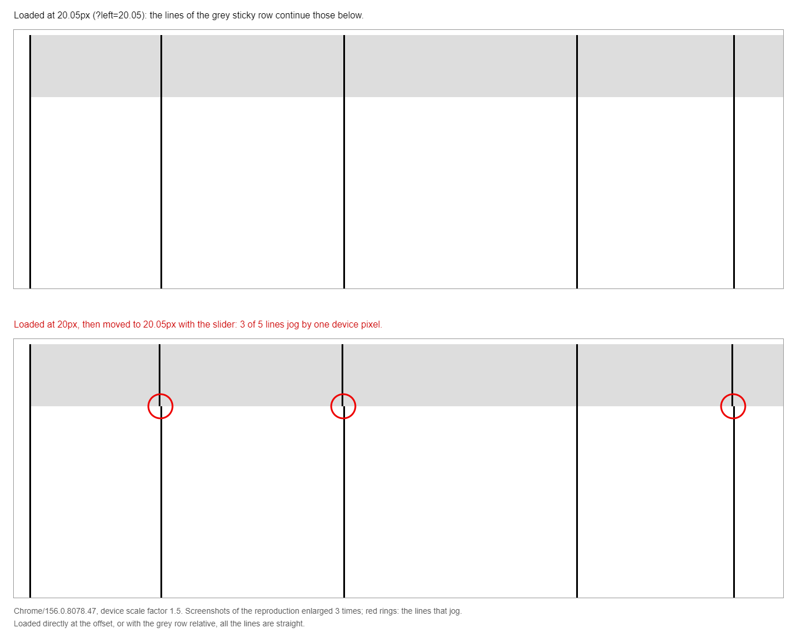
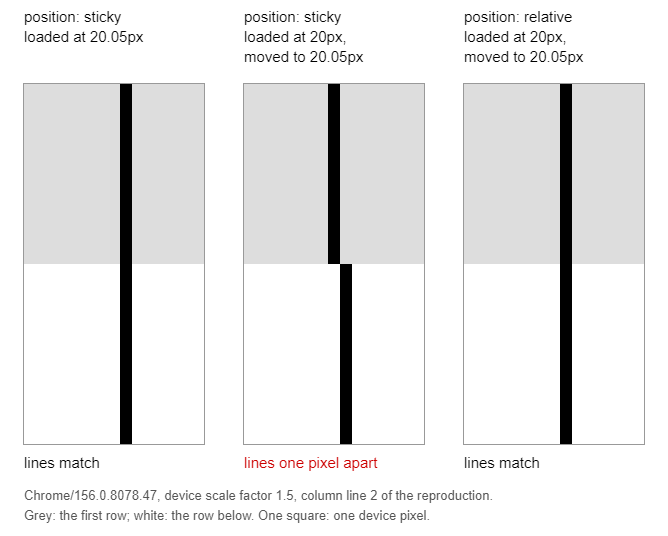
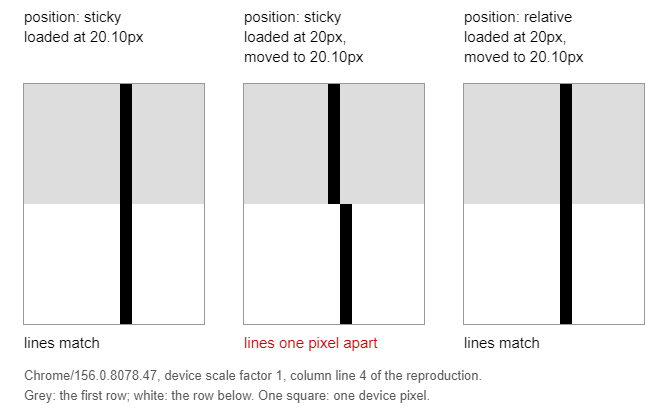

# Chromium: a sticky row draws its lines one pixel off the rows below after a move

Draft of a ticket for [Chromium](https://issues.chromium.org/issues/new) (component to choose
when posting: Blink>Paint or Blink>Compositing), to post from the maintainer's account, with the
three images of this folder attached. Prisme has no workaround: the limit is documented in
`docs/DEVELOPER.md`, section "Lines". The closest ticket,
[401693546](https://issues.chromium.org/issues/401693546) ("position: sticky elements are shifted
1px to the left"), was fixed in M135 by
[Avoid rounding inconsistency between Blink and cc](https://chromium-review.googlesource.com/c/chromium/src/+/6340249),
a heuristic for values starting at -0.5; the case below remains in Chrome 156.

Measured on 2026-11-04 with the page below, in headless Chrome started with
`--force-device-scale-factor`, each case on a fresh page: a screenshot of the first row and of the
row below it through the DevTools protocol, the dark pixels read across each row.

---

**Title:** `position: sticky row: after its scroll container moves by a fraction of a pixel, its borders are drawn 1 device pixel off those of the rows below`

### Chrome version

Chrome 156.0.8078.47, Windows 11 Pro 10.0.26300. Measured in headless Chrome started with
`--force-device-scale-factor` set to 1, 1.25, 1.5, 1.75 and 2.

### Steps to reproduce

1. Start Chrome with `--force-device-scale-factor=1.5` (or use a display scale of 150 %) and open
   the page below.
2. Move the slider from 20px to 20.05px: it moves the scroll container by 0.05px to the right.
   Zoom into a screenshot: the second vertical line of the grey sticky row stands one device pixel
   to the left of the same line in the white rows below.
3. Open the page at that offset directly, with `?left=20.05`: the lines match.
4. Open the page with `?position=relative`, then move the slider to 20.05px: the lines match.

```html
<!doctype html>
<html lang="en">
  <head>
    <meta charset="utf-8" />
    <title>Sticky row: vertical lines one pixel off the rows below</title>
    <style>
      body {
        margin: 0;
        font: 14px sans-serif;
      }

      p {
        margin: 8px;
      }

      /* The left offset of the scroll container, set by the slider. */
      .scroller {
        position: absolute;
        top: 80px;
        left: var(--left, 20px);
        width: 600px;
        height: 200px;
        overflow: auto;
      }

      .row {
        display: grid;
        grid-template-columns: 50.3px 70.7px 90.45px 60.2px 80.9px 300px;
        width: max-content;
        height: 24px;
      }

      .row > div {
        border-left: 1px solid black;
      }

      .sticky {
        position: sticky;
        top: 0;
        background: #ddd;
      }
    </style>
  </head>
  <body>
    <p>
      Left offset of the scroll container:
      <input id="left" type="range" min="20" max="22" step="0.05" value="20" />
      <output id="value">20px</output>. Moved by the slider, the vertical lines of the grey sticky
      row stand one device pixel beside those of the rows below at most offsets. Loaded at the
      offset (<code>?left=20.05</code>), they match.
    </p>
    <div class="scroller"></div>
    <script>
      const scroller = document.querySelector('.scroller')
      for (let row = 0; row < 12; row++) {
        const line = scroller.appendChild(document.createElement('div'))
        line.className = row === 0 ? 'row sticky' : 'row'
        for (let cell = 0; cell < 6; cell++) line.append(document.createElement('div'))
      }
      const left = document.getElementById('left')
      const value = document.getElementById('value')
      const place = (offset) => {
        document.body.style.setProperty('--left', `${offset}px`)
        value.textContent = `${offset}px`
      }
      left.addEventListener('input', () => place(left.value))
      // ?left=20.05 loads the page at that offset; ?position=relative unsticks the grey row.
      const query = new URLSearchParams(location.search)
      if (query.has('left')) {
        left.value = query.get('left')
        place(query.get('left'))
      }
      if (query.has('position')) scroller.firstElementChild.style.position = query.get('position')
    </script>
  </body>
</html>
```

### Expected result

The cells of the sticky row and of the rows below have the same layout positions
(`getBoundingClientRect().left` is equal for each column, at every offset). Their left borders
are drawn on the same device pixels, as when the page is loaded at the offset.

### Actual result

At a scale of 150 %, after the move from 20px to 20.05px, the borders are drawn at these device
pixels:

| Row | Columns 1 to 6 |
| --- | --- |
| sticky | 30, 105, 211, 347, 437, 559 |
| rows below | 30, 106, 212, 347, 438, 559 |

The sticky row draws its borders where it drew them at 20px. Loaded at 20.05px, it draws them at
30, 106, 212, 347, 438, 559, like the rows below.

As seen in the page, enlarged 3 times, at a scale of 150 % and an offset of 20.05px:



Around one column line, the bottom of the grey row and the top of the row below, one square per
device pixel, each panel from a fresh page. At a scale of 150 %, offset 20.05px, second column
line:



At a scale of 100 %, offset 20.10px, fourth column line:



Number of offsets where the lines are apart, out of the 41 offsets of the slider (20px to 22px by
0.05px), each case on a fresh page:

| Case | 1 | 1.25 | 1.5 | 1.75 | 2 |
| --- | --- | --- | --- | --- | --- |
| sticky, loaded at the offset (`?left=`) | 0 | 0 | 0 | 0 | 0 |
| sticky, loaded at 20px, moved to the offset | 36 | 30 | 28 | 26 | 28 |
| relative, loaded at 20px, moved to the offset | 0 | 0 | 0 | 0 | 0 |
| sticky, moved, then the border color of its cells changed | 0 | 0 | 0 | 0 | 0 |

### Impact

Data grids with a sticky header row (spreadsheet-like tables, SQL clients) show a one-pixel jog
between the column lines of the header and those of the body after the grid moves by a fraction of
a pixel, for example when a panel beside it is resized; a reload puts them back.
